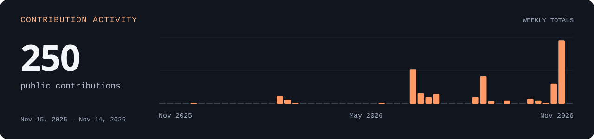

<picture>
  <source media="(max-width: 600px)" srcset="./assets/profile-hero-mobile.svg">
  
</picture>

## About

I'm **Wenrun Liao (廖雯润)**, known as **Jingzhao (璟昭)** at Alibaba. I work at **Taobao Shangou**, building AI applications for retail, with a background in frontend engineering.

My recent work spans merchant operations, replenishment workflows, and the tools and knowledge that support business agents.

## Focus

- **Retail AI & agents** — Integrating data, business rules, and tools into workflows with human review and verifiable results.
- **Knowledge engineering** — Developing reusable domain knowledge and Skills, with evaluation and review to guide iteration.
- **Frontend & developer experience** — Building web interfaces and tools for AI-assisted development across multiple repositories.

## Toolbox

  
  
  
  
  
  
  
  

## GitHub Activity

  
  

<picture>
  <source media="(max-width: 600px)" srcset="./assets/github-contributions-mobile.svg">
  
</picture>

Public GitHub activity · refreshed daily

## Connect

[liaowenrun@gmail.com](mailto:liaowenrun@gmail.com)
